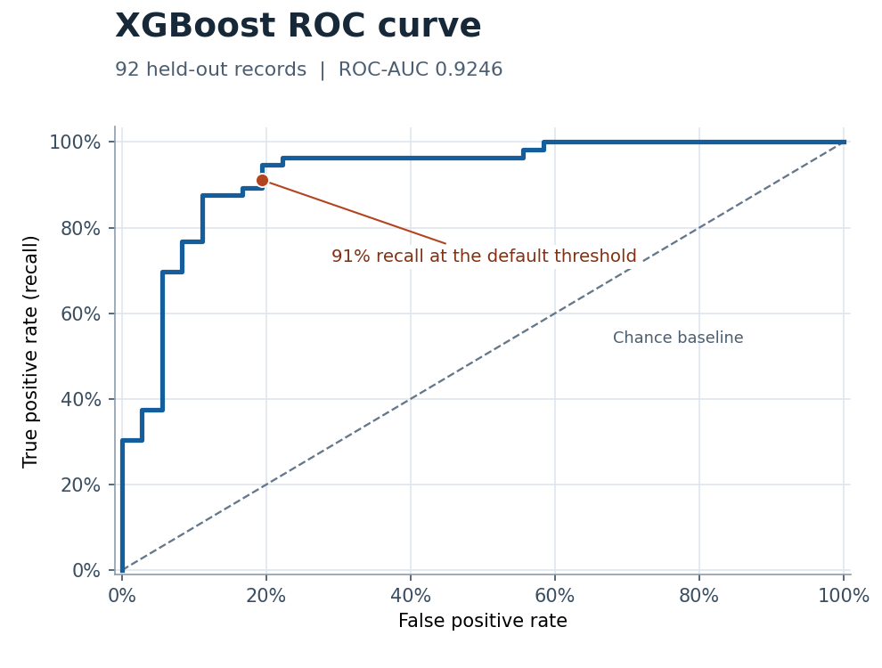

# Cardiovascular Disease Prediction

I implemented the XGBoost classifier for this three-person COS 422 project. We used Python and a shared pandas preprocessing pipeline to compare XGBoost with logistic regression and a PyTorch neural network on 918 heart disease records.

## Results

On the 92-record test split, XGBoost reached **0.9246 ROC-AUC** and detected **51 of 56 positive cases (91% recall)**. Logistic regression detected the same number of positive cases.

## OPTIONAL: View or download the ROC curve

[View or download the ROC curve (PNG)](xgboost-roc.png)

## Run the XGBoost model

1. Download heart.csv from the [Heart Failure Prediction Dataset on Kaggle](https://www.kaggle.com/datasets/fedesoriano/heart-failure-prediction) and put it next to XGBoost_model.py.
2. With Python 3.13, run these commands from this folder.

       python -m pip install -r requirements.txt
       python XGBoost_model.py

The script prints the classification metrics and opens a ROC curve. The original preprocessing computes the cholesterol median before splitting the data. Fitting imputation on the training split would be a next step for a stricter evaluation.
